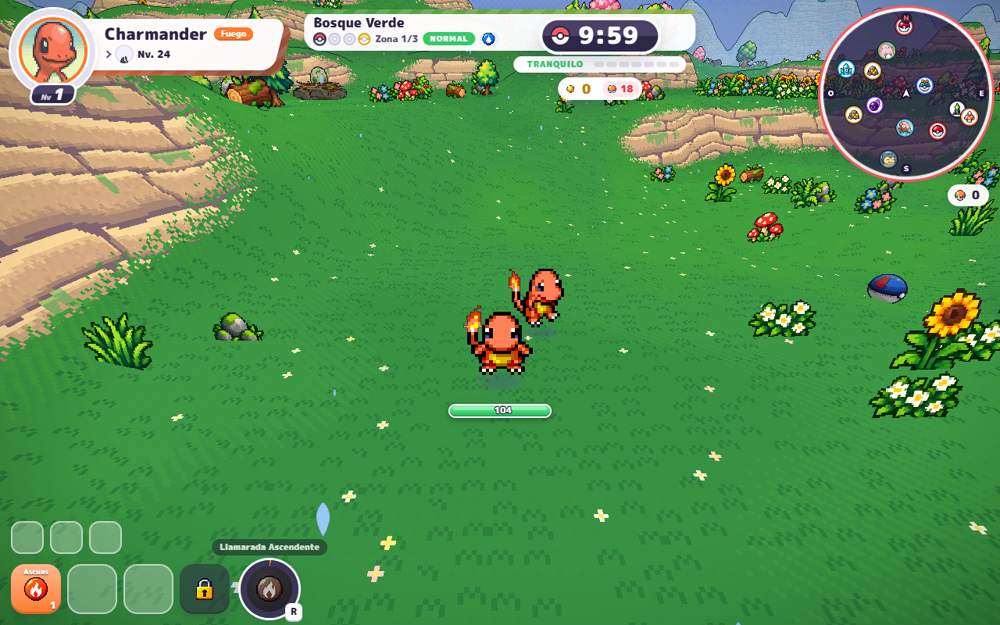
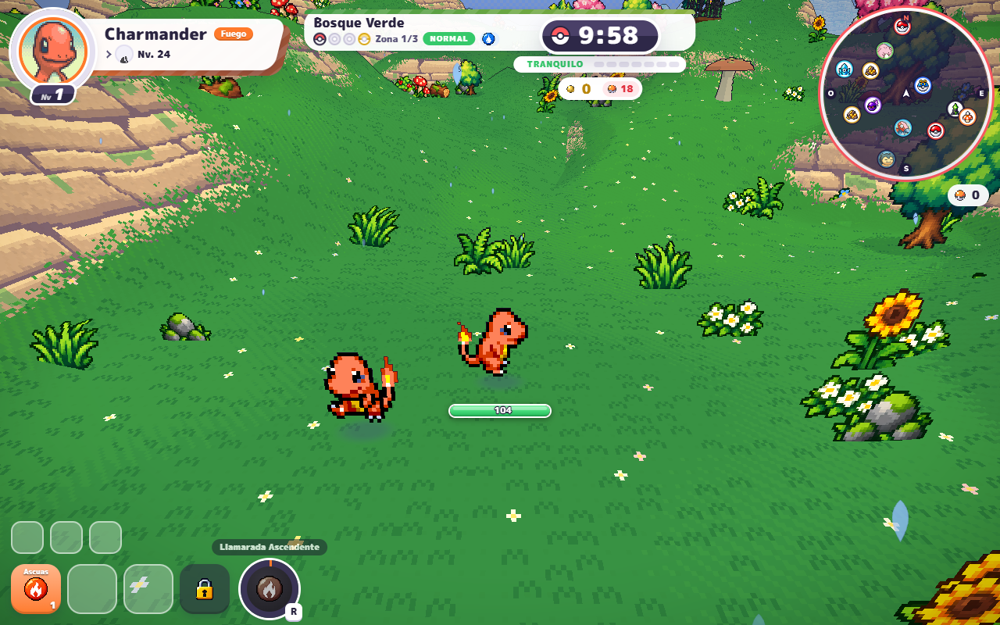

# PokéBonk — local reconstruction

Reverse-engineered reconstruction of the PokéBonk web client (build `mvilprw2`, v0.8.13),
running fully offline on `http://127.0.0.1:8080`.

## Run

```bash
node server.mjs        # or: PORT=9090 node server.mjs
```

Open http://127.0.0.1:8080/ → *Play as a guest* → pick a starter → *Play* → Enter.

## What is reconstructed

| Layer | Status |
|---|---|
| Client bundle (entry, i18n, news, three.js, CSS, fonts) | mirrored verbatim from `pokebonk.com/assets` |
| Game data (`data/*.json`: 1025 species, 919 moves, learnsets, abilities, items, sprites, types) | mirrored |
| Art/audio (`pmd`, `portraits`, `icons`, `items`, `cries`, `music`, `env/*`, `ui/*`, `models/*.glb`) | mirrored, 4.4k files |
| Backend API (`https://api.pokebonk.com`) | reimplemented in `server.mjs` against a JSON store |
| Cloudflare Turnstile | replaced by a local auto-pass stub |
| Cloudflare RUM beacon | stripped from `index.html` at serve time |

## How the client is redirected

`server.mjs` rewrites these while serving (serve-time string patches, applied once,
cached; a missing anchor logs `[pb-patch] anchor not found` instead of failing
silently). Nothing is written back to disk:

1. `assets/main-D5OUVqGK-mvilprw2.js` — the game bundle, loaded by the small
   `main-BcyzVqXo-mvilprw2.js` entry via `import()`:
   - `https://api.pokebonk.com` → `/api`
   - the Turnstile script URL → `/turnstile-stub.js`
   - `__pbMakePuppets`: `m.dex ?? run.startSpecies ?? 1` → `(m.dex | 0) || run.startSpecies || 1`
   - `DC.buildStage`: insert `__pbBuildPuppets(this)` after the local player
   - `DC.update`: insert `__pbSyncPuppets(this)` before `renderWorld`
   - `DC.renderCoopPlayers`: drop the interpolation clock, de-duplicate by uid
   - `DC.doLevelUp`: call `coop.localPicked()` when the card closes
   - `kh.credit`: guest guard so remote copies never count kills
2. `index.html`: drops the `static.cloudflareinsights.com` beacon.

The mirrored bundle already contains the co-op hooks the protocol needs
(`Sd` sidecar + `enemyAdded`/`enemyGone`, `kh.strike` hit forwarding, `Yg` puppet
guards, `DC.update` tick, `DC.simulate` guest split, `renderCoopPlayers`,
`__pbMakePuppets`). `assertMirrorHooks()` checks all of them on the first request
and warns if the mirror ever changes.

Everything else is byte-identical to the upstream build.

## Co-op

Co-op is host-authoritative: the host simulates enemies, pickups, team XP and the
clock; guests simulate only their own Pokémon and forward hits. Signaling goes
through the in-memory relay in `server.mjs` (`?local=1`).

In-game flow: *CO-OP* pill in the trainer bar → add a friend by name → *Create room*
→ *Invite* → both in the lobby → *Start run*. `public/net/coop-ui.mjs`
drives the bundle's own run-start path (menu → Liga → region screen → run), so no
manual clicking outside the UI is needed.



Both contexts see two Pokémon: the host's world (above) draws the guest's puppet,
and the guest's world draws the host's. Puppets are real `Yg` instances driven by
wire state (`pl.net` → `pos` every frame in `DC.update`), so they animate, face
the right way, and never gain XP, level up, or take local damage.



Known limits: the HUD has no teammate block yet, `enemyAdded` sends `shiny: 0`,
and ghost casts / remote pickup events are stubs in the bridge adapter.
## Languages

English is the default language across the client. A `?lang=xx` URL query parameter and the in-game language selector (persisted in `localStorage['pokebonk.lang']`) override this default for the upstream game content. The co-op UI always renders in English regardless of the active game locale.


## API surface (client contract, from static analysis)

Auth: `POST /auth/guest`, `POST /auth/login`, `POST /auth/register`, `POST /auth/upgrade`,
`POST /auth/logout`, `GET /auth/me`, `GET /auth/name?name=`.

Profile: `GET /profile` → `{profile, now}`, `PUT /profile/prefs`, `POST /profile/starter`,
`POST /lab/buy`, `POST /items/buy`, `POST /items/archive`, `POST /quests/claim`,
`POST /tasks/claim`, `POST /tasks/reroll`.

Runs: `POST /runs` → `{id, seed, ranked, boosts}`, `POST /runs/:id/checkpoint`,
`POST /runs/:id/finish` → `{profile, record, ranked, stardust, kills{...}, medal, ...}`,
`GET /runs/:id/build`.

Boards/season: `GET /leaderboard?mode=&season=&limit=`, `GET /leaderboard/pokemon`,
`GET /records`, `GET /records/endless`, `GET /seasons/awards`, `POST /seasons/claim`,
`GET /events/:id`, `POST /events/:id/track`, `POST /events/:id/quest`.

Social (stubbed single-player): `/clans/*`, `/friends/*`, `/mail*`, `/players*`, `/feedback`,
`/account/rename|reset|delete`.

Headers the client sends: `Authorization: Bearer <token>`, `X-Device`, `X-Client: 2`.

Client localStorage keys: `pb.session`, `pb.guest`, `pb.device`, `pb.pending`, `pb.live`,
`pb.liveBeat`, `pb.bypass`, `pb.news.seen`, `pb.tours`, `pb.swagpu`.

## Mirror tooling

- `tools/pull.mjs` — walks the entry bundle and pulls the reachable shell (JS/CSS/data/fonts).
- `tools/probe.mjs` — fetches every runtime-addressed asset family (`pmd/`, `portraits/`,
  `icons/`, `cries/`, `items/`, `env/`, `models/`, `ui/`) and writes hits to `public/`.
- `tools/mirror.mjs` — earlier crawl pass (kept for reference).

Missing assets are fetched from upstream on demand and cached into `public/`, so the mirror
heals itself the first time a new region/event is played.

## Provenance

Every file under `public/` is the upstream response body. Verified by SHA-256 against
`https://pokebonk.com/<same path>` for all 5,247 files:

| Result | Count | Explanation |
|---|---|---|
| identical | 5,244 | asset bytes are unchanged |
| `index.html`, `legal` | 2 | equal after stripping the `static.cloudflareinsights.com` beacon `<script>` that Cloudflare's edge injects into HTML at delivery. The stored copies are the origin HTML **without** it, so they are strictly cleaner than what the CDN serves. |
| `turnstile-stub.js` | 1 | written by this project; no upstream counterpart |

The email-obfuscation tokens (`email-protection#<key>`, `data-cfemail="<key>"`) use a fresh
random key per response, so raw hashes of HTML can never match; decoding them yields the
same plaintext (`contacto@pokebonk.com`) on both sides.

The served bundle is `public/assets/main-D5OUVqGK-mvilprw2.js` with exactly two string
substitutions (asserted by byte equality against the reconstructed expected output):

```
https://api.pokebonk.com                                     -> /api
https://challenges.cloudflare.com/turnstile/v0/api.js?render=explicit -> /turnstile-stub.js
```

Nothing else in the client is modified. Assets absent upstream (`items/tm.png`,
`front/1.png`, `ui/icons/*` gaps) are absent locally too — parity, not loss.

## State

`data/store.json` holds accounts, profiles and run history. Delete it to reset everything.

## Firebase backend (optional, `--firebase`)

`server.mjs` can run the same ~50-route API against Firebase instead of the JSON store, so
the reconstruction can be deployed without a stateful game server. The JSON store remains
the default; Firebase mode is opt-in and does not touch `data/store.json`.

```bash
npm install firebase-admin       # the only SDK dependency
node server.mjs --firebase       # or: FIREBASE=true node server.mjs
```

Credentials come from the environment (any one of):

- `FIREBASE_SERVICE_ACCOUNT` — JSON service-account key (inline JSON), or
- `GOOGLE_APPLICATION_CREDENTIALS` — path to a service-account key file, or
- Application Default Credentials (`gcloud auth application-default login`).

Plus `FIREBASE_PROJECT_ID` and `FIREBASE_DATABASE_URL` (the RTDB URL). Without
`firebase-admin` installed, `--firebase` prints a clear error and exits — the tests and the
JSON store still work, because the route logic is written against a DB interface with an
in-memory implementation (`firebase/backend.mjs` → `MemoryDB`).

### Store mapping

| JSON store (`data/store.json`) | Firebase |
|---|---|
| `accounts` | Firestore `saves/{uid}` — one doc per trainer; `id` = Firebase Auth uid |
| account identity | Firebase Auth (Anonymous for guests; Email+Password for register) |
| auth bearer token | opaque token the server issues (stored on the save doc, `where token ==`) |
| password | scrypt hash on the save doc (same as JSON store) |
| active run + checkpoints | RTDB `runs/{runId}` — config, seed, `cps[]` |
| run history | `saves/{uid}.profile.runs` (same shape as JSON store, capped at 50) |
| presence | Firestore `pres/{uid}` — 30-min heartbeat |
| rooms / signaling | RTDB `rooms/{id}/{host, open, at, m, q}` |

Auth detail: the client sends `{name, password}` with no email, so the backend synthesises
an email (`<name>-<rand>@pokebonk.local`) for the Firebase Email+Password user and still
verifies login against the scrypt hash (no REST round-trip, no API key). The bearer token
the client stores in `pb.session` is a server-issued opaque token — consistent across both
backends, and chosen because the client never initialises the Firebase SDK itself.

### Free-tier (Spark) limits

- **Realtime Database**: 100 simultaneous connections, 10 GB/month download, 1 GB stored.
- **Firestore**: 20,000 writes/day, 50,000 reads/day, 20,000 deletes/day, 1 GiB storage.
- **Authentication**: 50,000 monthly active users (anonymous + email/password combined).

The backend is written to stay inside these limits:

- **One Firestore document write per run finish** (the `saves/{uid}` doc). Run history is
  appended inside that same document, not a separate collection.
- **Checkpoints never touch Firestore** — they go to RTDB under `runs/{runId}` (skipped
  entirely if RTDB is not configured).
- **Profile saves are debounced** to at most one Firestore write per 65 s per user.
- **Presence** is one Firestore write per 30 minutes, not per request.

### Cost-per-feature table

| Feature | Firestore cost | Notes |
|---|---|---|
| Guest account create | 1 write (immediate) + 1 Auth user | negligible |
| Register / login / rename / upgrade / delete | 1 write (immediate) + Auth call | negligible |
| Profile prefs, lab, items, quests, tasks | 1 write per 65 s (debounced) | ~≤1,300 writes/day per always-on player |
| Run finish | 1 write (the save doc) | history lives inside `saves/{uid}` |
| Checkpoints | 0 Firestore writes | RTDB only |
| Presence heartbeat | 1 write per 30 min | 48 writes/day per player |
| Leaderboard / players / search | 1 read per account (collection scan) | scales with player count — cache if it grows |

### Deploy (Firebase Hosting + Auth + Firestore + RTDB)

The API is a plain `node:http` server; Firebase Spark (free) does **not** include Cloud
Functions, so the API process itself needs somewhere to run. Two options:

1. **Stateless API + Firebase state (recommended).** Run `server.mjs --firebase` on any free
   Node host (Render / Fly.io / Railway / Cloud Run's free tier). It holds no state — every
   write goes to Firebase — so it scales horizontally and restarts cleanly.
2. **Fully on Firebase (Blaze plan).** Wrap `server.mjs --firebase` as an HTTP Cloud
   Function and rewrite `/api/**` to it in `firebase/firestore.rules`'s sibling
   `firebase.json` hosting block.

Steps for the Firebase side:

```bash
npm install firebase-admin firebase-tools
npx firebase login
npx firebase init firestore database hosting --project <project-id>
# deploy the included rules + config (they live in firebase/)
npx firebase deploy --only firestore:rules,database:rules,hosting
# enable: Authentication → Sign-in method → Anonymous + Email/Password
# create a service account, then:
FIREBASE_SERVICE_ACCOUNT='<json>' FIREBASE_PROJECT_ID=<id> \
  FIREBASE_DATABASE_URL=https://<id>-default-rtdb.firebaseio.com \
  node server.mjs --firebase
```

Firebase Hosting serves the static `public/` tree. Note: `server.mjs` rewrites
`https://api.pokebonk.com` → `/api` in the client bundle **at serve time**, which plain
Hosting does not do. To serve the client off Hosting without `server.mjs`, run
`node tools/prepatch.mjs` (see "Deploying the client statically" below) to produce a
pre-patched `deploy/` tree, or keep serving `public/` through `server.mjs` and use Firebase
only for Auth/Firestore/RTDB state.

### Tests

```bash
node --test firebase/backend.test.mjs
```

Covers guest create → `/auth/me` → `/profile` get → `/profile` save → `/runs` POST →
`/runs/:id/finish` (persisting end to end) against the in-memory DB, plus register/login,
name availability, leaderboard ranking and auth failures — no Firebase SDK or emulator
required.

### Co-op signaling (Firebase)

The co-op netcode (`net/net.mjs`) uses the Realtime Database for WebRTC signaling and for a
relay path when a direct WebRTC connection can't be established. To give it a working DB
handle in the browser, load the client-side adapter `net/signaling-firebase.mjs`:

```html
<script type="module">
  import * as Sig from './net/signaling-firebase.mjs';
  import * as Net from './net/net.mjs';

  const cfg = {
    apiKey: '<web-api-key>',
    authDomain: '<project-id>.firebaseapp.com',
    projectId: '<project-id>',
    databaseURL: 'https://<project-id>-default-rtdb.firebaseio.com',
  };

  // Sign in anonymously (or with Email+Password) so every RTDB write is keyed to a uid.
  const db = await Sig.initAnonymous(cfg);   // { rtdb, uid, auth, ServerValue }
  Net.init(db, db.uid);                       // net.mjs consumes { rtdb, uid }
  Net.open(roomId, isHost, hostUid);
</script>
```

The four config keys come from the Firebase console → Project settings → General → Your apps →
Web app → "SDK setup and configuration" (`apiKey`, `authDomain`, `projectId`, `databaseURL`).
The adapter loads the Firebase JS SDK **compat** API from the gstatic CDN (no npm dependency)
and returns `{ rtdb, uid, auth, ServerValue }`, exactly the shape `Net.init(db, uid)`
consumes. If you already sign in through your own Firebase Auth flow, call `Sig.init(cfg, uid)`
with the authenticated uid instead of `initAnonymous`.

Rooms live under `rooms/{id}/{host, open, at, m/{uid}, q/{to}/{msg}}` (see
`firebase/database.rules.json`): the host writes `host`/`open`/`at`, each member writes their
own `m/{uid}` presence entry, and any member pushes signals/messages to another member's
`q/{to}` queue. Tear down `m/{uid}` with `onDisconnect().remove()` so a stale member never
holds one of the RTDB **100 simultaneous connections** open on the free tier.

### Deploying the client statically (no server.mjs)

Firebase Hosting cannot rewrite the bundle at serve time the way `server.mjs` does, so
produce a pre-patched deploy tree first:

```bash
node tools/prepatch.mjs            # copies public/ -> deploy/ and patches the bundle
# set firebase.json "hosting.public" to "../deploy", then:
npx firebase deploy --only hosting
```

`tools/prepatch.mjs` copies `public/` verbatim (byte-for-byte) and applies the same two
substitutions `server.mjs` performs at serve time to the bundle only:
`https://api.pokebonk.com` → `/api` and the Turnstile script URL → `/turnstile-stub.js`.
The original `public/` tree is never modified.

